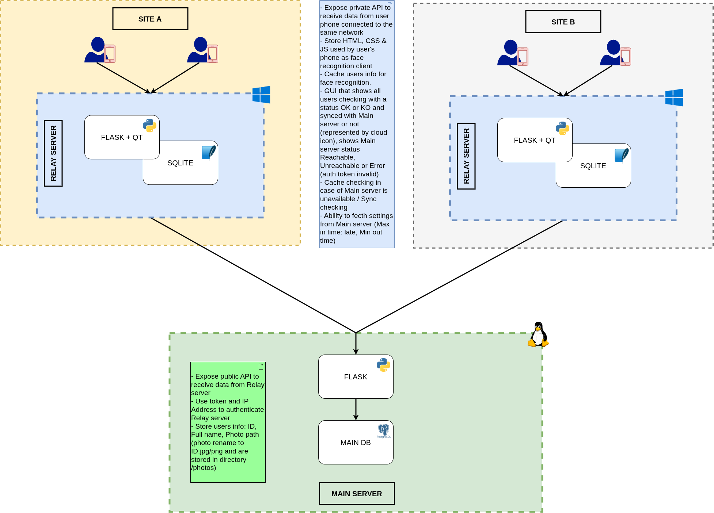
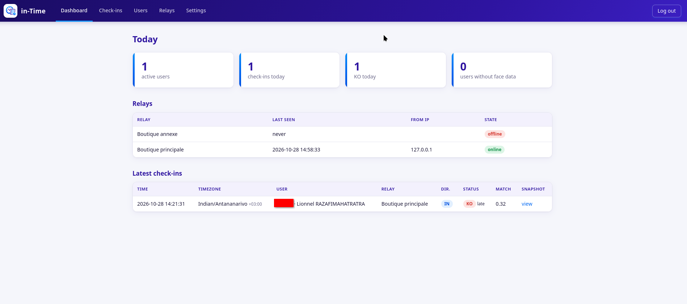
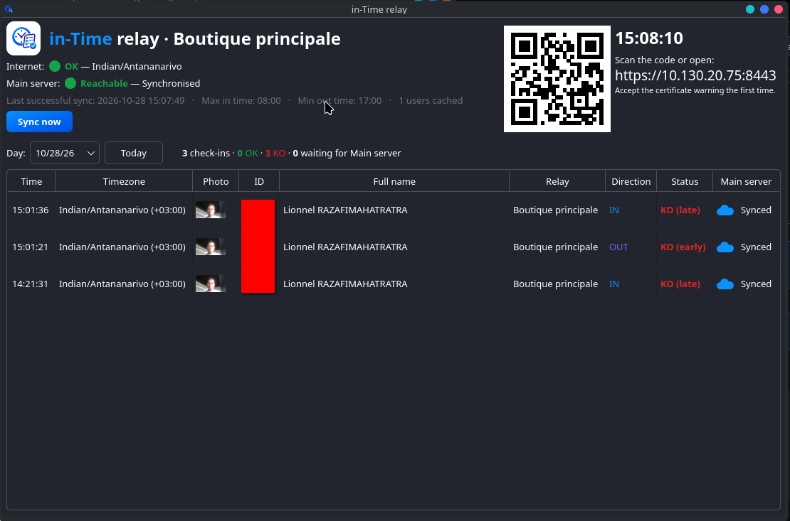

# in-Time

Face-recognition attendance system for multi-site organisations. Employees check **in** and **out**
by looking at a phone camera on their site's Wi-Fi. Each site runs a small **relay server** that keeps
working offline, and a central **main server** collects everything.

```
 Phones (browser) ──LAN / HTTPS──▶ RELAY SERVER  (Windows, one per site)
                                    Flask + Qt window + SQLite cache
                                          │  HTTPS, token + IP authentication
                                          ▼
                                   MAIN SERVER  (Linux)
                                   Flask + PostgreSQL + admin web console
```



*Global architecture. The editable source is [`archi.drawio`](archi.drawio) (open it with [draw.io](https://app.diagrams.net)).*

## Screenshots

**Web admin console** (main server): dashboard with today's check-ins, users, relays and settings.



**Relay GUI** (one per site): QR code for phones, trusted clock, internet and main server status, and today's check-ins.



## Features

- **Face recognition on the relay**: the phone only takes the picture; the relay identifies the person (OpenCV YuNet + SFace), so a check-in can't be forged by sending a request with someone's ID.
- **Face check on the main server**: every check-in snapshot is compared again with the user's photo; mismatches, missing faces and missing snapshots are flagged on the dashboard for review.
- **Tamper-proof time**: check-in times come from Google over HTTPS, never from the relay PC's clock, so changing the Windows date/time has no effect.
- **Main-server outages tolerated**: the relay caches users and settings, decides OK/KO locally and syncs check-ins when the main server is reachable again. Without **internet**, new check-ins are refused (no trusted time).
- **Late / early detection**: IN after *max in time* or OUT before *min out time* is flagged KO. Global values with per-site overrides.
- **Relay window**: today's check-ins with OK/KO, sync state per row, main server status (Reachable / Unreachable / Error), QR code for phones.
- **Admin console**: users (photo upload or camera capture, face check), relays (tokens, allowed IPs), settings, check-in history with filters and CSV export, snapshot of every check-in.
- **Relay authentication**: bearer token + allowed IP/CIDR list; works behind nginx/Apache/Traefik and Cloudflare.

## Repository layout

| Folder | Contents |
|---|---|
| `main_server/` | Public API for relays + admin web console (Flask, PostgreSQL) |
| `main_server/postgres/` | PostgreSQL 16 for the main server (Docker Compose) |
| `relay_server/` | Relay: phone web client, private LAN API, sync worker, Qt window (Flask, PySide6, SQLite) |

## How it works

1. **Admin** adds users (ID, full name, department, photo) on the main server. The server checks that the
   photo has one usable face and keeps its face data as the reference. The photo is saved as `photos/<ID>.jpg|png`.
2. **Relays** sync every 30 s: ping, settings, users and their photos. Each relay computes the face data
   of new or changed photos itself.
3. **Phones** on the site's Wi-Fi open `https://<relay-ip>:8443`. The phone only detects that a face is in
   front of the camera, then sends the picture to the relay, which recognises the person. The person sees
   their name, IN/OUT is suggested (alternating during the day) and sent after 4 s unless they tap the
   other option.
4. The **relay** accepts the check-in only with the one-time token it issued for that picture, stamps it
   with the trusted (internet) time, decides OK/KO, keeps the picture as the snapshot, stores it in SQLite
   and pushes it to the main server immediately, or later if the main server is unreachable.
5. The **main server** compares the snapshot with the user's photo again and flags the check-in if they
   don't match (see [Face check](#face-check-and-anti-fraud)).

### Face check and anti-fraud

The phone never decides who is checking in, and never receives anyone's face data or photo list:

- `POST /api/identify` (picture) → the relay finds the face and compares it with every user's photo.
  When it matches, it returns the name and a **one-time token** valid 90 s for that phone only.
- `POST /api/checkins` (token, IN/OUT) → accepted only with that token; the stored snapshot is the
  picture the relay recognised. Requests with a user ID, a reused or a fake token are refused.
- Identification requests are rate-limited per phone (15 per 10 s).

On the main server, every snapshot received is compared with the user's photo. The **Face check** column
of the check-ins shows *match* (with the similarity), or flags *mismatch*, *no face* or *no snapshot*;
the dashboard counts flagged check-ins of the day and the Check-ins page can filter them. Flagged
check-ins are still recorded: review the snapshot and decide. Check-ins received while the models were
loading are checked by a background pass within a minute; `flask --app main verify-checkins` runs it on
demand (`--all` re-checks everything, e.g. after changing `FACE_MIN_SIMILARITY`).

Limits: there is no liveness detection, so holding a printed photo or a screen in front of the camera can
still fool it; every check-in keeps its snapshot for review. Photos, snapshots and face data are
**biometric personal data**: keep them out of version control (see `.gitignore`), restrict access, and
check the data-protection rules that apply to you.

### Trusted time and internet check

The relay reads the time from `https://www.google.com/generate_204` (the HTTPS `Date` header) every
60 s. Between two checks it counts with the system's monotonic clock, which does not move when someone
changes the Windows clock, so a changed PC date/time has no effect on check-ins (the relay window only
shows a warning). If the time check fails, the relay shows a red banner, the phones show
"check-in unavailable", and new check-ins are refused until the connection is back (retried every 10 s).
If the PC date is wrong by months, the secure connection itself fails and the relay asks to fix the date.

The site's time zone is set in `relay.ini` (`[time] timezone`), so changing the Windows time zone has no
effect either. Without it the PC time zone is used and the relay window shows a warning.

| Situation | Check-ins |
|---|---|
| Internet OK, main server OK | accepted, synced immediately |
| Internet OK, main server down | accepted, synced when it is back (grey cloud) |
| No internet | refused |

## Getting started

Requirements: Python 3.10+, Docker (for PostgreSQL) on the main server, Windows or Linux for the relay.
Both servers download their models automatically on first start: face-api.js (npm registry, used by the
admin pages and the phone page) and the OpenCV face models (~39 MB, OpenCV model zoo, checked by SHA-256).
On a machine without internet, copy `app/static/vendor/` and `models/` (main server) or `data/vendor/`
and `data/models/` (relay) from another installation.

### Main server (Linux)

**As a systemd service (recommended).** On the server, with sudo rights:

```bash
curl -sSL https://raw.githubusercontent.com/dijey099/in-Time/refs/heads/master/main_server/install_main_server.sh | sh
```

**Manually:**

```bash
cd main_server
cd postgres && cp .env.example .env && docker compose up -d && cd ..   # set POSTGRES_PASSWORD first
python3 -m venv .venv && . .venv/bin/activate
pip install -r requirements.txt
cp .env.example .env          # set SECRET_KEY, ADMIN_PASSWORD, DEPARTMENTS (and DATABASE_URL)
python main.py                # development: http://localhost:8000
# production (behind nginx + HTTPS):
gunicorn -w 4 -b 127.0.0.1:8000 main:app
```

Tables are created automatically. Log in, then **Relays → Add a relay**: enter the public IP(s) the site
connects from (CIDR allowed, `*` = any, for testing only) and copy the token, which is shown once.
`flask --app main create-relay "SITE A" --ips 203.0.113.10` does the same from the shell.

The camera option on the user page needs the admin console to be served over HTTPS (or `localhost`).

### Relay server (Windows / Linux)

1. Copy `relay_server/relay.ini.example` to `relay.ini` and set the main server `url` and `token`
   (and the site `[time] timezone`).
2. Allow phones to reach the relay on TCP port 8443, once:
   - Windows (as administrator): `netsh advfirewall firewall add rule name="in-Time relay" dir=in action=allow protocol=TCP localport=8443`
   - Linux (ufw): `sudo ufw allow 8443/tcp`
3. Start the relay in one of two ways.

**Executable.** Put `start_relay.exe` (Windows) or `start_relay` (Linux) in the folder with `relay.ini`
and double-click it. Its `data/` folder is created next to it. Double-clicked, the Windows executable hides
its console and only the relay window shows. Run from a terminal (`start_relay.exe --no-gui`), it runs
headless and prints the log there. The log is always in `data/relay.log`, and start-up errors (missing
`relay.ini`, port already in use...) are also shown in a message box.

**From source.** With Python 3.10+:

```bash
cd relay_server
python -m venv venv
venv\Scripts\activate          # Linux: . venv/bin/activate
pip install -r requirements.txt
python start_relay.py           # --no-gui runs it headless
```

**Building the executable.** In the activated venv, run `pip install pyinstaller`, then `build.bat` (Windows)
or `sh build.sh` (Linux): it creates `dist/start_relay(.exe)` from [`relay.spec`](relay_server/relay.spec).
Build on the OS you target, from a venv that only has `requirements.txt` installed (PyInstaller bundles
every package it can import). OpenCV (face recognition) makes up a large part of the executable
(about 130 MB on Linux); the face models are not bundled but downloaded into `data/models` on first start.

On first visit, phones show a certificate warning (self-signed certificate, needed because browsers only
allow the camera over HTTPS): accept it once. The certificate is regenerated if the relay's LAN IP
changes, so give the relay PC/Server a fixed IP or DHCP reservation.

## Configuration

### Main server (`main_server/.env`)

| Variable | Purpose |
|---|---|
| `SECRET_KEY` | Flask session key: use a long random value |
| `DATABASE_URL` | PostgreSQL URL |
| `ADMIN_USERNAME`, `ADMIN_PASSWORD` | Admin console login |
| `DEPARTMENTS` | **Required.** Comma-separated departments, e.g. `Sales,Direction,Manager`; every user must belong to one. The server refuses to start without it |
| `PHOTOS_DIR`, `SNAPSHOTS_DIR` | Where user photos and check-in snapshots are stored |
| `TRUSTED_PROXIES` | Number of reverse proxies in front of the app |
| `CF_PROXY` | `true` when Cloudflare is in front |
| `CF_IPS_FILE` | Cloudflare ranges file (default `cf_ips.txt`) |
| `FACE_MIN_SIMILARITY` | Face check: similarity (0-1) between snapshot and photo required for a match (default `0.363`, higher = stricter) |
| `FACE_MODELS_DIR` | Where the OpenCV face models are stored (default `models`) |

### Relay IP behind a reverse proxy / Cloudflare

The allowed-IP check needs the relay's real (public) IP:

| Setup | `.env` |
|---|---|
| No proxy | `TRUSTED_PROXIES=0`, `CF_PROXY=false` |
| nginx / Apache / Traefik on the same host | `TRUSTED_PROXIES=1` (proxy must send `X-Forwarded-For`) |
| Cloudflare → app, or Cloudflare Tunnel | `CF_PROXY=true` |
| Cloudflare → nginx → app | `CF_PROXY=true` and `TRUSTED_PROXIES=1` |

With `CF_PROXY=true` the IP comes from the `CF-Connecting-IP` header, accepted only when the request
arrives from a Cloudflare IP range or a local/private address; a forged header sent straight to the server
is refused. With nginx in between, also set `TRUSTED_PROXIES=1` so requests that bypass Cloudflare are
detected too (or firewall the server to Cloudflare's ranges). The IP seen for each relay is shown on the
Relays page under *Last seen*.

**Local relays.** A relay on the same network as the main server can be marked *Local relay* (Relays page).
Its IP is then the address that opened the connection: `TRUSTED_PROXIES` and `CF_PROXY` are ignored for it,
and forwarded headers are never trusted, so it must connect directly to the app port (not through the proxy),
e.g. gunicorn listening on the LAN (`-b 0.0.0.0:8000`) with its LAN IP in *Allowed IPs*.

Cloudflare's ranges live in `main_server/cf_ips.txt`. Keep them current with `python update_cf_ips.py`:
it rewrites the file only when Cloudflare's list changed (`--check` only reports), and the server reloads
the file on its own. The install script schedules it every 2 hours (`/etc/cron.d/in-time-cf-ips`,
log in `/var/lib/in-time/cf_ips_update.log`). For a manual installation, example cron job (every 2 hours):

```
17 */2 * * * cd /path/to/in-Time/main_server && .venv/bin/python update_cf_ips.py >> cf_ips_update.log 2>&1
```

### Relay (`relay_server/relay.ini`)

See [`relay.ini.example`](relay_server/relay.ini.example): main server URL and token, sync interval,
port, duplicate window, data folder, the `[face]` section (`min_similarity`, default 0.363, higher =
stricter) and the `[time]` section (site `timezone`, time source `urls`, `check_interval`).

## Relay API

`/api/v1`, header `Authorization: Bearer <token>`:
`GET /ping`, `GET /settings`, `GET /users`, `GET /users/<id>/photo`, `POST /checkins` (idempotent by uuid;
each check-in carries its snapshot, which the main server checks against the user's photo).

## Contributing

Issues and pull requests are welcome; please use the templates. By contributing you agree that your
contributions are licensed under the GPL-3.0.

## License

Copyright (C) 2026 Dijey

This program is free software: you can redistribute it and/or modify it under the terms of the
GNU General Public License as published by the Free Software Foundation, either version 3 of the
License, or (at your option) any later version. See [`LICENSE`](LICENSE).

face-api.js (downloaded at run time) is © Vladimir Mandic and contributors, MIT License.
